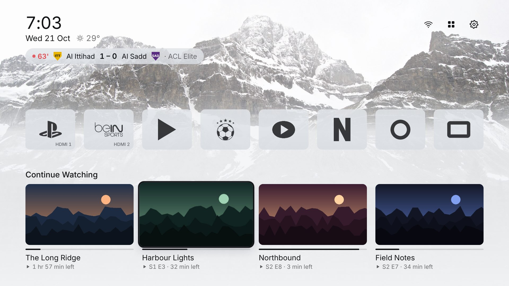
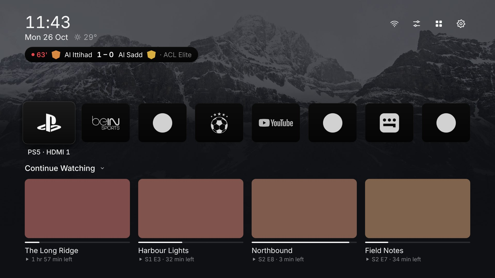

# Plume for Samsung (S90CA)

A calm, ad-free home screen for Samsung Tizen TVs, built after
[Plume Launcher](https://github.com/aradhyas8/Plume_Launcher) for Android TV, with today's football added.

## What's in it

- **Home screen:** clock, date and weather, the mountain wallpaper (light, dark or automatic at sunset), one row of app logos, and Plex Continue Watching.
- **Match strip** under the date. It shows a live match with the score and minute, and rotates through matches when several are live (a match of one of your teams stays put). Before anything starts, it shows the next big match with a countdown. When the day's matches are over, it disappears. OK on a live match switches to beIN; on an upcoming one it sets a reminder.
- **App row:** the TV's own app icons turned into clean single-colour marks, or tinted in each app's colour. Hold OK on a tile to move it or remove it. **PS5** (HDMI 1) and **beIN** (HDMI 2) have their own tiles; the ports are set in Settings → Inputs. App names: on focus, always, or never.
- **Matches tile:** Yesterday / Today / Tomorrow, grouped by competition, with scorers, stadium and a countdown. Beside the list: the focused match's league table, group or cup round. Press Right to select the table and OK to open the whole table with the competition's coming matches for the next two weeks.
- **Competitions:** Saudi Pro League, King's Cup, AFC Champions League Elite and Two (matches with Saudi clubs), Club World Cup, Saudi Arabia's matches (World Cup qualifiers, Asian Cup, Gulf Cup, friendlies), and the Premier League, La Liga and Champions League (all matches).
- **Your teams:** Al Hilal, Saudi Arabia and Manchester United. Their matches always show and come first.
- **Match alerts:** kick-off, goals (with the scorer) and full time of your teams' matches and the ones you set a reminder for. They pop up over anything Plume shows, the PS5 and beIN included, go away after 10 seconds and never take the remote. Not over a film playing in Plume. Live scores refresh every 25 seconds while one of these matches is on. Settings → Football → *Match alerts*.
- **Matches page:** a strip of dates a month back and a month ahead (Today first); each day loads when you open it. OK on a match opens a menu: *Match details* first (before, during and after the match: stats, goals, cards and changes, line-ups on a pitch from the team's formation; it refreshes itself during the match and when line-ups are due), then *Watch on beIN* (live), *Watch highlights* (finished) or *Remind me* (coming), and *Whole table*.
- **Highlights:** searched on YouTube and ranked: the competition's broadcaster or league channel first (Thmanyah, beIN, Premier League, LaLiga, UEFA, AFC…), then the clubs' channels, then any channel; a video counts only if it was posted after kick-off and its title has the score or both teams. They play inside Plume (OK pauses, ◀ ▶ jump 10 s, Back closes) through a one-page player on GitHub Pages ([ali530/plume-player](https://github.com/ali530/plume-player)), because YouTube's embedded player only plays on a web page with a real address; a channel that allows its videos only on YouTube opens in the YouTube app, and the message says YouTube's reason.
- **League page** (Right on the table beside the list, then OK): the whole table, and one list of results and coming matches two weeks each way, opening at today.
- **Reminders** pop up 10 minutes before kick-off while Plume is on screen. OK switches to beIN.
- **Sleep screen** after 1½ minutes (before the S90CA's own protection screen at 2 minutes) idle: drifting mountain and nature photos, a large clock with the date and weather, and up to three live or upcoming matches.
- **Plex player:** a Continue Watching card plays right where you stopped, inside Plume, with Samsung's own video player (4K, HDR10, Dolby Vision, Dolby Atmos). Settings and Info on the left, −10 / pause / +10 in the middle, Next episode on the right; Up for the progress bar (hold to speed up). Each episode starts with Plex's own choices for it: its subtitle track, its audio track and its Original quality. The gear lists that episode's subtitles and audio, its Original (resolution and bitrate) and the lower steps below it; changes are saved to Plex. Several presses of −10/+10 make one jump. The next episode plays after a 10-second countdown, from the same version. Your position is saved to Plex on every version of the title. Info shows the version playing and how subtitles are shown.
- **Episodes:** hold OK on an episode in Continue Watching → *Episodes*: the show's seasons and episodes, with progress and watched marks. OK plays any episode in Plume's player.
- **Hide:** hold OK on a card. *Remove from Continue Watching* takes away that one title until it's watched again. *Hide this show* (or *movie*) keeps the whole show off Plume, including episodes watched later on another device using the same Plex account. Plex itself keeps everything. Settings → Plex → *Hidden* lists hidden shows and movies; OK brings one back.
- **Subtitle timing:** ⚙ → *Subtitle timing*, ◀ earlier / ▶ later by half a second, remembered per episode (for subtitles Plume draws). *Search subtitles online* lists the ones made for your exact file first.
- **Subtitles:** SRT, WebVTT and ASS files are drawn by Plume (ASS: lines at the top stay at the top, two lines at once, styling dropped). A subtitle stored inside the video that the server won't hand over and the TV can't read (ASS, often) is fetched another way, automatically: first the server repackages the video (picture and sound copied, no quality loss) and sends the subtitles as text; if it refuses, it draws them into the picture. Info → Subtitles says which.
- **Versions** (4K and 1080p, or original and dubbed): one card plays the version you played last: if you watched a version further in the Plex app since you last stopped in Plume, that one; otherwise the one you played in Plume (with no history yet: the one furthest along, then 4K). Info shows which version is playing and why. Hold OK on the card to pick another version (*Play · 4K*, *Play · Arabic*, …); Plume remembers it. Settings → Plex → *Default quality*: Last played, 4K or 1080p (same language only).
- **Fold rows away:** press Up from the cards to reach a row's title (Continue Watching, or Today's matches when that row is on) and press OK to fold the row away; OK again opens it. Plume remembers it.
- **Smooth on the TV:** rows slide on the graphics chip, focus effects fade ready-made layers, posters load at the size shown, and a held arrow never builds up a backlog.
- **Settings** (gear icon): theme, wallpapers, logos, app names, apps in the row, the optional matches row on the home screen, Plex account and server, competitions, your teams, HDMI ports, sleep delay, weather city.

## Install on the S90CA (about 15 minutes)

Tizen Studio and your Samsung certificate are already set up on your PC from the first TV. What's new is this TV.

1. **Developer Mode on the TV.** Open **Apps**, press **1 2 3 4 5** on the remote, turn **Developer mode** on, enter your PC's IP address, then restart the TV (hold the power button until it restarts).
2. **Connect it.** Tizen Studio → Tools → **Device Manager** → Remote Device Manager → **+**. Name `S90CA`, the TV's IP, port `26101` → Add → switch **Connection** on.
3. **Certificate for this TV.** Tizen Studio → Tools → **Certificate Manager** → **+** → **Samsung** → **TV** → profile name `S90CA` → **Use an existing author certificate** (the one from your first TV) → sign in with your Samsung account → in the distributor step, check that the S90CA's **DUID** is listed (it appears while the TV is connected) → Finish. Make sure `S90CA` is the active profile.
4. **Install.** Unzip `Plume-S90CA.zip` on the Desktop, open the folder and double-click **install.bat**. It asks nothing: it uses the certificate profile `S90CA` (edit the PROFILE line if yours differs) and the TV that's connected in Device Manager, and remembers the TV's address in `install.cfg`. It packages, signs, installs and opens Plume.

If the Desktop is inside OneDrive, unzip it anywhere else (for example `C:\Plume`) and run `install.bat` from there.

## YouTube key for highlights (optional, about 10 minutes, free)

Without a key Plume reads YouTube's plain search page, which YouTube sometimes blocks. With a key it uses YouTube's official search.

1. Go to **console.cloud.google.com** and sign in with a Google account.
2. At the top, **Select a project → New project**, name it `Plume`, **Create**, and select it.
3. **APIs & Services → Library**, search **YouTube Data API v3**, open it and press **Enable**.
4. **APIs & Services → Credentials → Create credentials → API key**. Copy the key (it starts with `AIza`).
5. Optional but wise: on that key, **Edit → API restrictions → Restrict key → YouTube Data API v3 → Save**.
6. Open `Plume\youtube-key.txt`, paste the key on its own line, save, and run `install.bat` again.

Settings → Football → *YouTube key for highlights* then shows **Set**. The free allowance (about 100 searches a day) is far more than needed; each finished match you open costs one or two searches, and results are remembered for a few hours.

## First run on the TV

- **Connect Plex:** Plume shows a code. On your phone, go to **plex.tv/link** (or scan the QR code) and enter it.
- **Put Plume first:** Home → highlight Plume → press Down → **Move** → first place.
- **Open with the TV:** Settings → General → Smart Features → turn on **Autorun Last App**, and turn off **Autorun Smart Hub**. Leave Plume open when you turn the TV off.
- **Inputs:** if the PS5 or beIN is on a different port, change it in Plume → Settings → Inputs.
- **Your own tile pictures:** any tile can use a picture you add to `Plume\img\tiles\`: `ps5.png`, `bein.png`, `matches.png`, or an app's name such as `youtube.png`, `disney.png`, `shahid.png`, `netflix.png` (a logo on a transparent background, 256 px or larger). Run `install.bat` again afterwards.

## Samsung limits

- Samsung doesn't let apps replace Smart Hub or the Home button. Plume is an app: put it first in the apps bar and use Autorun Last App.
- The sleep screen and reminders work only while Plume is on screen. The S90CA's own protection screen (the black screen with moving lights) comes 2 minutes after the last button press and ignores an app's request to hold it; only a playing video keeps it away. So while Plume's sleep screen is on, Samsung's own player plays a silent 720p black loop, copied once to the TV's Downloads/Plume folder (the player can't read files inside an app). Any button stops it. Tested on the S90CA: no black screen.
- Apps have no direct "switch input" command. Plume shows the PS5 or beIN inside Plume, and Back returns to Plume. For the PS5, turn on Game Mode in the TV's picture menu if you notice lag.
- Plex: Samsung's Plex app can't be told to play a title from another app, so Plume plays it itself. If a title won't play here, Plume offers to open the Plex app instead. Lower qualities need your server to convert, which your provider may not allow.
- Closing an app opened from Plume should bring you back to Plume. Some Samsung apps don't allow that and go to Samsung's home; then press Home and pick Plume.
- Logos come from the TV's own app icons. If the TV won't let Plume read an icon, it shows the icon as it is (greyed in Mono mode).

## Privacy

No account, no ads, no tracking. Plume connects only to:
- **plex.tv** and your Plex server, for Continue Watching (Plume never sees your Plex password),
- **ESPN's public scoreboard feed**, for fixtures, scores and the table,
- **Open-Meteo**, for the weather of the city you pick,
- **Unsplash**, for the sleep screen photos,
- **YouTube**, only when you ask for a match's highlights.

## Files

| | |
|---|---|
| `Plume/` | The TV app (HTML, CSS, JavaScript; no build step) |
| `Plume/js/` | `home.js` home screen · `football.js` feed and rules · `centre.js` match centre · `plex.js` · `apps.js` app row and logos · `settings.js` · `sleep.js` · `tv.js` Samsung APIs |
| `install.bat` | Package, sign, install and open on the TV (Windows) |
| `tests/harness.py` | Runs Plume in a browser with a stand-in TV, feed and Plex server, and checks the remote-control flows |

## Credits

- Design after **Plume Launcher** by aradhyas8 (MIT).
- Wallpaper: "Canada" by Thomas Curryer, via Unsplash (CC0), as bundled with Plume Launcher.
- Sleep screen photos: Unsplash (Unsplash License), loaded at run time.
- Font: Inter (SIL Open Font License). QR codes: qrcode-generator by Kazuhiko Arase (MIT).
- Football data: ESPN. Weather: Open-Meteo. All trademarks belong to their owners.
